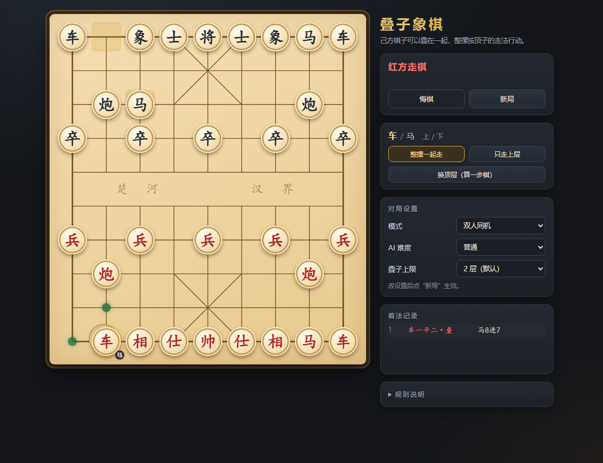
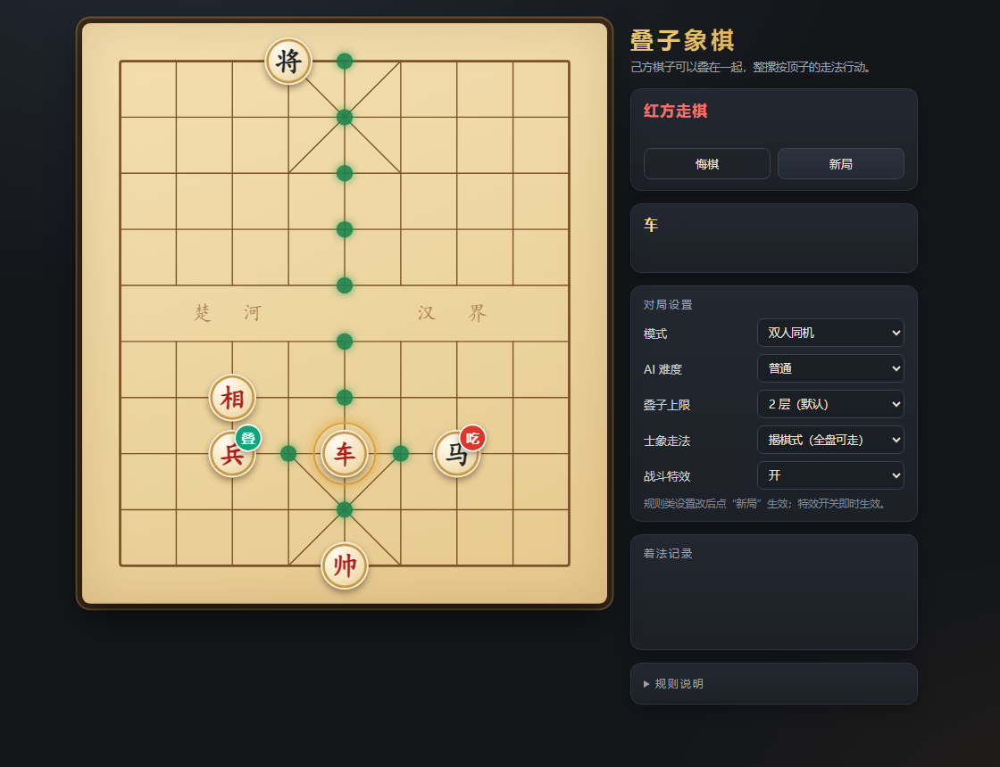

# 叠子象棋

中国象棋的一个改造玩法：**己方的棋子可以叠在一起**，整摞按顶子的走法行动。

纯静态网页版，零依赖，双击 `index.html` 就能玩（Node 只用于跑测试）。



## 玩法规则

| 规则 | 说明 |
|---|---|
| 叠子 | 己方棋子按**自身走法**走到己方棋子所在格，形成一摞；这一手算一步棋 |
| 顶层决定一切 | 整摞视为一个子，走法、吃法完全由**顶层子**决定；底层子不提供走法，也不额外占位（一格仍只算一个子、一个炮架） |
| 同命 | 整摞被吃则全部被吃。吃子时默认整摞一起过去，也可以只让顶层去吃、底子留在原地 |
| 拆分 | 顶层可以单独走开（走到空格或吃掉敌子），剩下的子留在原地并露出新的顶层；这也是正常的一步棋 |
| 换顶层 | 原地调整摞内顺序，**算一步棋**，且该手不能吃子 |
| 将帅 | 将/帅不参与任何叠子（既不能被叠，也不能叠别人） |
| 士象 | 揭棋式：士斜走一格、象走田（象眼会被塞），**不受九宫和河界限制**；开局设置里可切回“分区制”（在自家防区内受约束，出了防区才解禁） |
| 上限 | 默认 2 层，可在开局前改（3 层是实验选项） |
| 胜负 | 吃将 / 将死 / 困毙获胜；三次重复局面判和 |

几个自然涌现的战术：

- **载具流**：车驮马 = 用车的速度把马空投到敌人腹地；马驮车 = 慢速把车送进去（特洛伊木马）。
- **反叠手段**：炮和兵照样能吃掉整摞，低子换高子是天然平衡；把兵推到对方的大摞旁边就是一种威慑。
- **代价**：叠起来的东西被吃就一起没，所以叠得越厚越怕对方的“开罐器”。

## 战斗特效

对局设置里可以开关（即时生效）：

| 时机 | 表现 |
|---|---|
| 走子 | 半透明残影从起点滑到落点，落点棋子等残影到位才显形；起点留虚线框、落点留高亮框 |
| 吃子 | 橙红光环炸开 + 火星四散 + 被吃子的残影 + 震屏 |
| 将军 | 将帅上红色冲击环 + 浮起的“将”字 + 棋盘边缘红光 |
| 合体（叠子） | 两个青色光点向中心汇聚 + 收缩光环 |
| 拆分（只走上层） | 落点绽开 + 原格蓝光一闪（底子露出来） |
| 换顶层 | 紫色光环 |

AI 出招有节奏控制：走完至少停留 0.9–1.8 秒（按难度），不会一闪而过。

## 棋盘标记



| 标记 | 含义 |
|---|---|
| 绿点 | 可以走到的空格 |
| 棋子右上角青色“叠” | 可以叠上去的己方棋子（合体） |
| 棋子右上角红色“吃” | 可以吃掉的敌子 |
| 金色圆环 | 当前选中的棋子 |
| 琥珀虚线框 | 上一步的**起点** |
| 琥珀实线框 | 上一步的**落点** |

## 运行

直接双击 `index.html`。或在目录里起个静态服务：

```
python -m http.server 8080
```

然后访问 <http://localhost:8080>。

## 测试

```
node tests/run-tests.js   # 规则引擎 25 项用例
node tests/dom-smoke.js   # 界面点击链路冒烟测试
```

## 目录

```
index.html      页面结构
style.css       样式
rules.js        规则引擎（纯逻辑，浏览器 / Node 共用，UMD）
ai.js           简易 AI（负极大值 + Alpha-Beta + 迭代加深 + 时间上限）
app.js          界面与交互
tests/          测试
```

## 引擎接口

```js
const g = XQ.createGame({ maxStack: 2, switchCostsMove: true, relaxedAE: true });
XQ.legalMoves(g);          // [{from, to, kind, capture?, index?}]
XQ.play(g, mv);            // 落子，返回中文记谱；非法返回 null
XQ.undo(g);
g.result;                  // null 或 {type:'win'|'draw', ...}
```

着法 `kind` 的含义：

- `stack`：整摞移动 / 整摞吃子（`capture: true`）
- `top`：只走顶层（拆），底子留在原地
- `load`：叠到己方子上
- `switch`：原地换顶层（`index` 表示把第几个子提到顶层）

棋盘是长度 90 的数组，一格是 `null` 或数组（第一个是底子，最后一个是顶子）。

## 以后加后台

现在不需要后台。要加联机/存档时，Java 完全可行：

- JDK 17 自带的 `com.sun.net.httpserver.HttpServer` 就能零依赖起服务，或用 Spring Boot。
- 建议把 `rules.js` 1:1 移植成 Java 作为**服务端权威校验**，前端只负责渲染和收集操作，防止改前端作弊。
- 引擎是纯函数式的（`genLegal` / `doMove`），没有 DOM 依赖，移植量可控。

## 待确认的规则细节

1. 士/象默认用揭棋式（全盘可走）；设置里的“分区制”是另一种口味，两种都留着方便对比手感。
2. 炮叠到己方子身上时不需要炮架（按不吃的走法过去），隔子只能吃不能叠。
